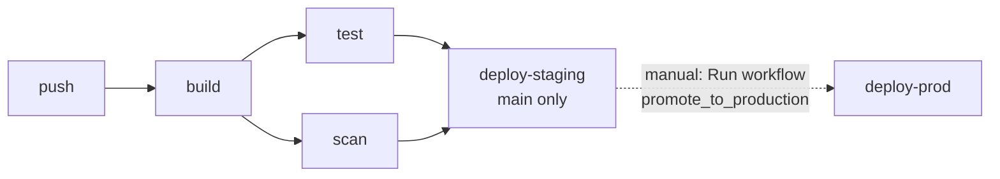

# CI/CD Workflow Development

Working repo for designing, reviewing, and documenting a GitHub Actions CI/CD pipeline
for containerized (Docker) projects in **private** GitHub repos. Plans, decisions and
workflow versions are recorded here before anything is adopted in a project repo.

This is a personal working record. It's public to read, but contributions aren't accepted.

## Status

| Item | State |
|---|---|
| Current workflow | [`workflows/ci-cd.yml`](workflows/ci-cd.yml) — **v4**, lint-clean (actionlint + shellcheck + yamllint), **not yet run on GitHub** |
| Target project repo | Not chosen yet |
| Active plan | [`plans/2026-11-25-cicd-pipeline-plan.md`](plans/2026-11-25-cicd-pipeline-plan.md) |

## Layout

```
.
├── README.md                     ← you are here
├── CHANGELOG.md                  ← workflow version history (v1 → v4)
├── docs/
│   ├── 01-cicd-concepts.md       ← what CI/CD is, pipeline stages, QA/GMP analogy
│   ├── 02-glossary.md            ← push, lint, canary, SBOM, DORA, etc.
│   ├── 03-github-actions.md      ← how GitHub workflows execute
│   ├── 04-workflow-review.md     ← line-by-line review of v2 and the fixes
│   ├── 05-decisions.md           ← decision log (why the pipeline looks like this)
│   └── diagrams.md               ← Mermaid diagrams (render natively on GitHub)
├── plans/
│   └── 2026-11-25-cicd-pipeline-plan.md
├── workflows/
│   ├── ci-cd.yml                 ← current version (copy to .github/workflows/ to use)
│   └── history/                  ← every prior version, kept for the record
└── examples/
    └── Dockerfile.example        ← multi-stage runtime/test Dockerfile the workflow expects
```

> **Note:** the workflow lives in `workflows/`, **not** `.github/workflows/`, on purpose.
> This repo has no Dockerfile or app, so putting it under `.github/workflows/` would make
> every push here trigger a failing pipeline. Copy it into a project repo to use it.

## Pipeline at a glance



## Using the workflow in a project repo

1. Copy `workflows/ci-cd.yml` → `<project>/.github/workflows/ci-cd.yml`.
2. Give the project a multi-stage Dockerfile with `runtime` and `test` stages
   (see `examples/Dockerfile.example`).
3. Add `scripts/deploy.sh <environment> <image>`.
4. Work through the setup checklist in the active plan.
