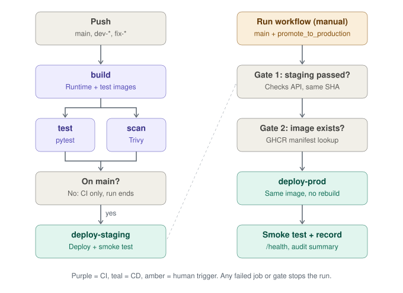
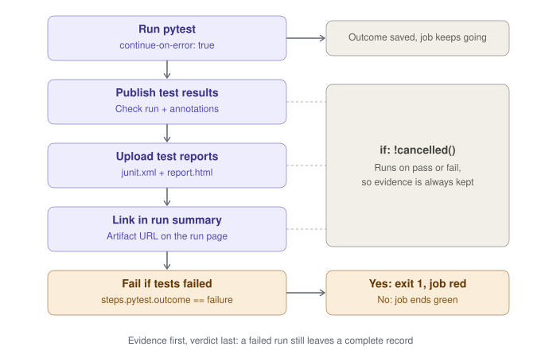
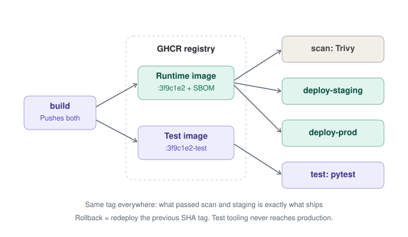

# Job reference — `ci-cd.yml` v4

What each job does, when it runs, and what fails it.

| Job | Type | Runs when | Waits on |
|---|---|---|---|
| `build` | CI | Every push to `main`, `dev-*`, `fix-*`. Skipped on a promotion run | — |
| `test` | CI | After `build`, in parallel with `scan` | `build` |
| `scan` | CI | After `build`, in parallel with `test` | `build` |
| `publish-test-report` | Optional | `main` only, `PUBLISH_PAGES=true`, test ran (pass or fail) | `test` |
| `deploy-staging` | CD | Push to `main`, after build, test and scan all pass | `build`, `test`, `scan` |
| `deploy-prod` | CD, manual | "Run workflow" on `main` with `promote_to_production` | — (CI jobs skipped) |

---

## `build`

Builds the production and test images once, tagged by commit SHA.

- **Permissions:** `contents: read`, `packages: write`
- **Steps:**
  1. Check out the code.
  2. Compute image names: `ghcr.io/<owner>/<repo>:<sha>` and `:<sha>-test` (lowercased).
  3. Log in to GHCR with `GITHUB_TOKEN`.
  4. Build and push the **runtime** image with SBOM, provenance (`mode=max`) and OCI labels.
  5. Build and push the **test** image, reusing runtime layers from cache.
- **Hands off:** `image` and `test_image` outputs, read by test, scan and deploy-staging.
- **Fails when:** Dockerfile errors, missing `runtime`/`test` stage, GHCR push denied, 30-minute timeout.

## `test`

Runs pytest inside the test image and keeps the evidence even when tests fail.

- **Permissions:** `contents: read`, `packages: read`, `checks: write`, `pull-requests: write`, `issues: read`
- **Steps:**
  1. Log in to GHCR; create `test-results/`.
  2. Run pytest as the runner uid with `continue-on-error` → `junit.xml` + `report.html`.
  3. Publish test results as a check with annotations.
  4. Upload the `test-reports` artifact (30 days).
  5. Link the artifact in the run summary.
  6. Fail the job if pytest failed.
- **Hands off:** `artifact_url` output, read by publish-test-report.
- **Fails when:** any failing test (after evidence is saved), image pull error, pytest missing from the test image.

## `scan`

Checks the runtime image for known vulnerabilities and keeps a SARIF report.

- **Permissions:** `contents: read`, `packages: read`
- **Steps:**
  1. Log in to GHCR and pull the runtime image.
  2. Generate a full SARIF report (all severities; never fails).
  3. Gate: rescan with the cached vulnerability DB, fail on HIGH/CRITICAL.
  4. Upload the `trivy-results` artifact (30 days).
- **Hands off:** `trivy-results` artifact (audit evidence).
- **Fails when:** any HIGH or CRITICAL CVE; Trivy tag missing or unpullable.

## `publish-test-report` (optional)

Publishes the latest main-branch test report to GitHub Pages.

- **Permissions:** `pages: write`, `id-token: write`
- **Steps:** download `test-reports` → add `index.html` → configure, upload and deploy Pages → write links to the run summary.
- **Hands off:** Pages URL in the `github-pages` environment.
- **Fails when:** Pages not enabled or not available on the plan. Outside Enterprise the site is public.

## `deploy-staging`

Deploys the scanned, tested image to staging and checks it came up.

- **Permissions:** `contents: read` (add `id-token: write` only if `deploy.sh` uses OIDC)
- **Concurrency:** `deploy-staging`, never cancelled mid-flight.
- **Steps:**
  1. Check out (for `scripts/deploy.sh`).
  2. `./scripts/deploy.sh staging <image>`.
  3. Smoke test `STAGING_URL/health` with retries (if the variable is set).
- **Hands off:** a successful `deploy-staging` check run on this SHA, which gate 1 looks for later.
- **Fails when:** `deploy.sh` exits non-zero, health check never returns 200.

## `deploy-prod` (manual)

Promotes the already-staged image to production after two gates.

- **Permissions:** `contents: read`, `checks: read`, `packages: read`
- **Concurrency:** `deploy-production`, never cancelled mid-flight.
- **Steps:**
  1. Compute the image name for this SHA.
  2. **Gate 1:** the Checks API must show a successful `deploy-staging` for this SHA.
  3. Log in to GHCR.
  4. **Gate 2:** `docker manifest inspect` must find the image.
  5. `./scripts/deploy.sh production <image>`.
  6. Smoke test `PROD_URL/health` (if set).
  7. Record commit, image and promoter in the run summary.
- **Hands off:** production running the same image staging validated, plus an audit record.
- **Fails when:** staging not yet passed for this SHA, image missing, deploy or smoke test fails.

