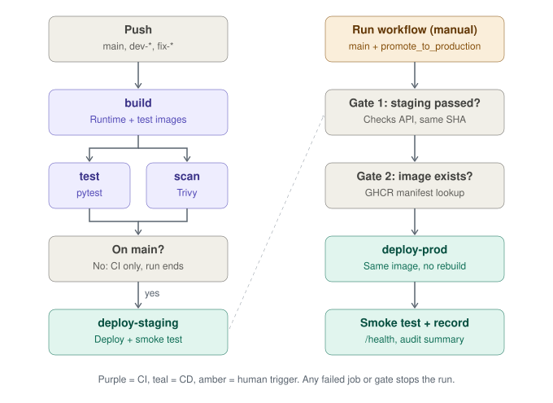
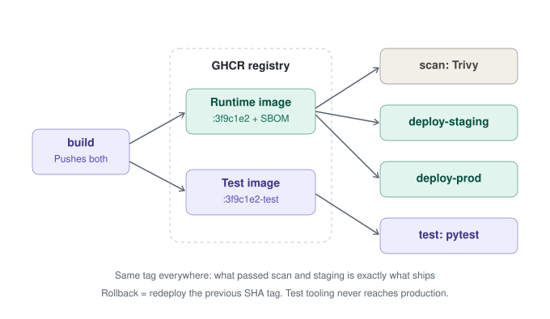
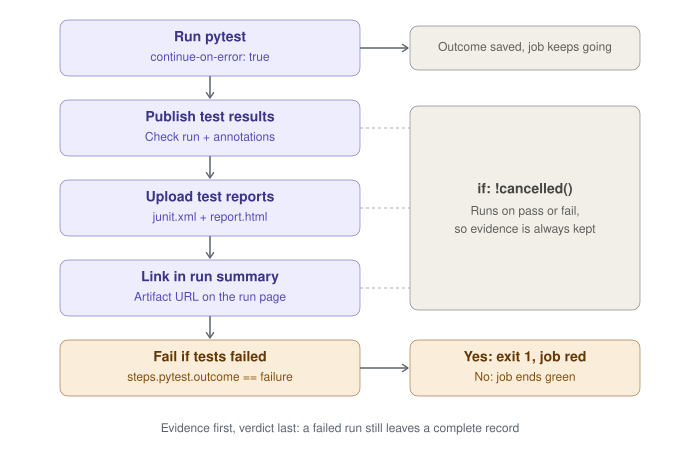
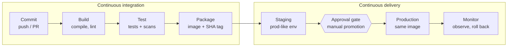
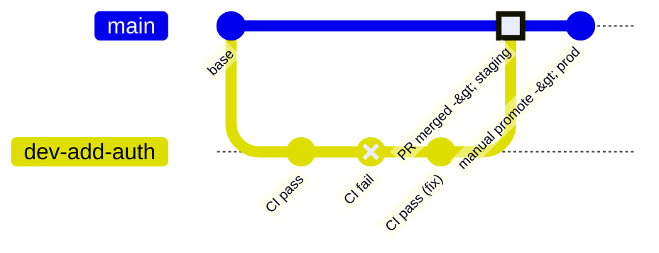
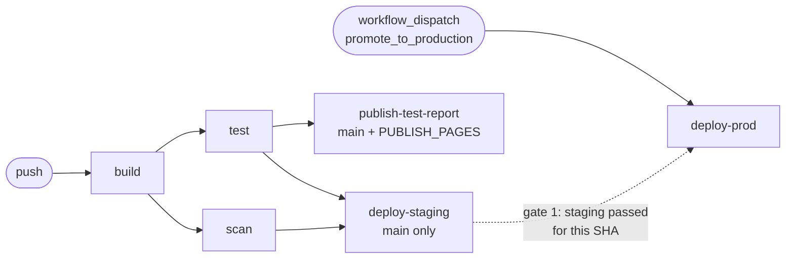
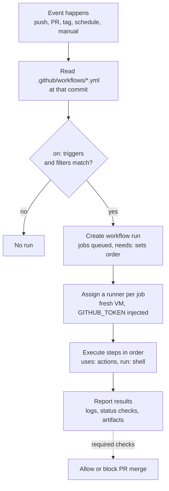
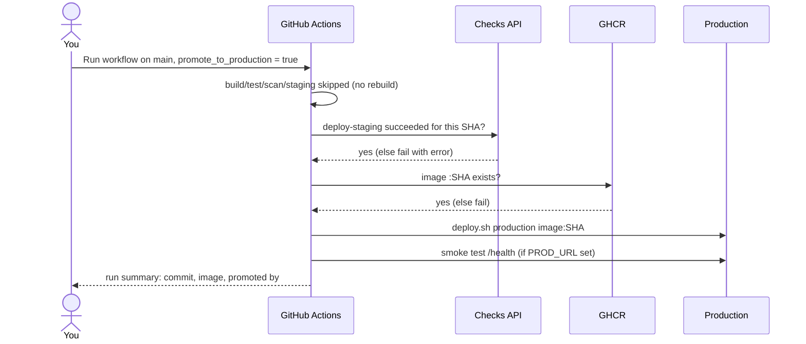

# Diagrams

Illustrations (SVG, adapt to light/dark mode) followed by Mermaid sources; GitHub renders both inline.

## Illustrations

| | |
|---|---|
| **v4 overall flow** — push path vs manual promotion |  |
| **Build once, promote many** — one SHA-tagged image through every stage |  |
| **Test job evidence pattern** — evidence first, verdict last |  |

Per-job details: [`06-job-reference.md`](06-job-reference.md). Scenario walk-through: [`07-scenarios.md`](07-scenarios.md).

## Mermaid sources

## 1. Pipeline overview

The approval gate is what separates continuous **delivery** (gate kept) from continuous
**deployment** (gate removed). A failure at any stage stops the run.

## 2. When CI and CD run (git flow)

- Every push to `dev-*` / `fix-*` → CI.
- PR into `main` → required checks + review gate the merge.
- Merge to `main` → CI + deploy to staging.
- Manual "Run workflow" on `main` → production.

## 3. Job dependency graph (v4)

## 4. GitHub Actions run lifecycle

## 5. Production promotion (v4)

